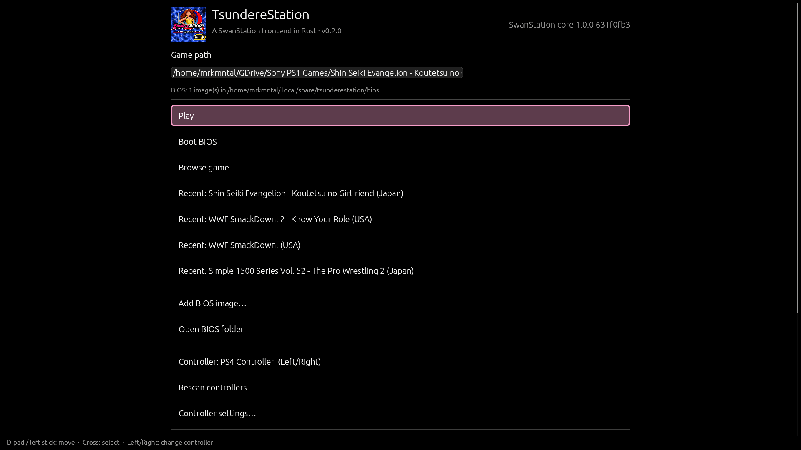
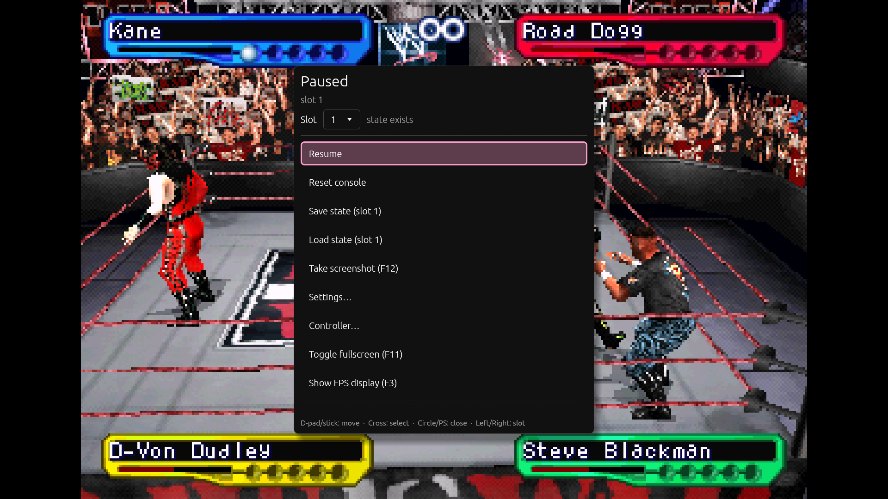
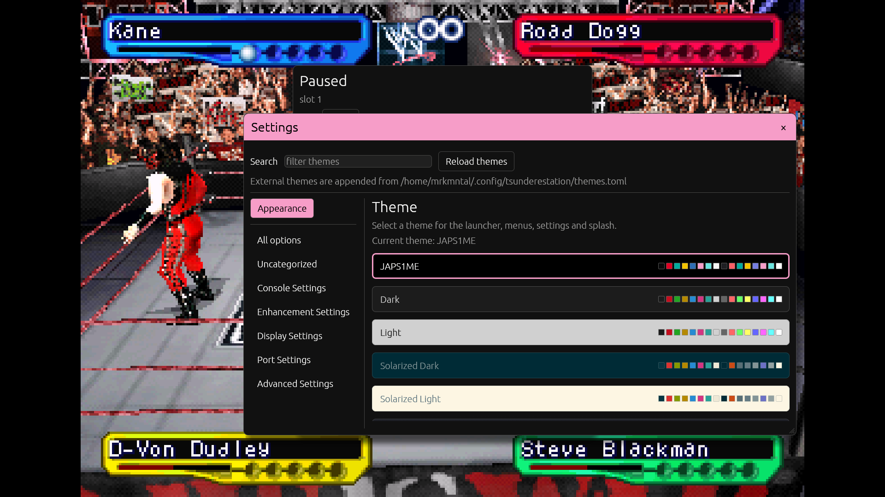
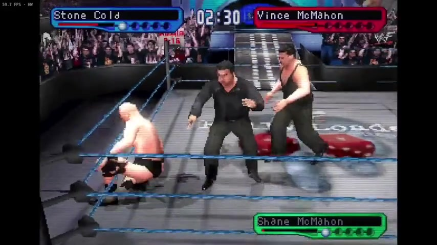

<p align="center">
  
</p>

<h1 align="center">TsundereStation</h1>

<p align="center"><em>“Anta baka?! Are you an idiot?!” — The Tsundere, after catching you using a non-free PS1 emulator like DuckStation.</em></p>

TsundereStation is free software: a standalone SwanStation PlayStation 1 emulator
front-end written in Rust with egui/eframe and SDL2. It loads
`swanstation_libretro.so` directly; RetroArch is not required.

It focuses on playing PS1 games with a good, controller-friendly TV UI. No
Discord integration, no RetroAchievements, no trophy popups, no bells and
whistles. Just the core, the games, and a tsundere attitude.

Settings, Controller and the Memory Card Manager are full-screen pages with
controller navigation. The game view supports built-in custom GLSL CRT shaders
and an optional stretch-to-fill display mode.

The app includes the TsundereStation logo and a short startup splash with the
provided motif. Both assets are embedded in the binary.

## Screenshots

<p align="center">
  
</p>
<p align="center"><em>Launcher with controller-first navigation and recent games.</em></p>

<table>
  <tr>
    <td align="center" valign="top">
      
    </td>
    <td align="center" valign="top">
      
    </td>
  </tr>
  <tr>
    <td align="center"><em>In-game pause menu with FPS and renderer status.</em></td>
    <td align="center"><em>Full-screen Settings with controller navigation.</em></td>
  </tr>
</table>

## Demo

<p align="center">
  <a href="tsunderestation-site/assets/demovid_480p.mp4">
    
  </a>
</p>
<p align="center"><em>▶ Watch the 90-second demo of the launcher, full-screen pages, CRT shaders and gameplay.</em></p>

### Game screenshots

These are direct `F12` screenshots from TsundereStation.

<table>
  <tr>
    <td align="center" valign="top">
      
    </td>
    <td align="center" valign="top">
      
    </td>
    <td align="center" valign="top">
      
    </td>
  </tr>
  <tr>
    <td align="center"><em>Shin Seiki Evangelion — dialogue scene.</em></td>
    <td align="center"><em>Shin Seiki Evangelion — another dialogue scene.</em></td>
    <td align="center"><em>WWF SmackDown! 2 — match action.</em></td>
  </tr>
  <tr>
    <td align="center" valign="top">
      
    </td>
    <td align="center" valign="top">
      
    </td>
    <td align="center" valign="top">
      
    </td>
  </tr>
  <tr>
    <td align="center"><em>WWF SmackDown! 2 — four-wrestler match.</em></td>
    <td align="center"><em>WWF SmackDown! 2 — Kane entrance.</em></td>
    <td align="center"><em>WWF SmackDown! 2 — KO finish.</em></td>
  </tr>
</table>

<details>
<summary>More game screenshots</summary>

<table>
  <tr>
    <td align="center" valign="top">
      
    </td>
    <td align="center" valign="top">
      
    </td>
    <td align="center" valign="top">
      
    </td>
  </tr>
  <tr>
    <td align="center" valign="top">
      
    </td>
    <td align="center" valign="top">
      
    </td>
    <td align="center" valign="top">
      
    </td>
  </tr>
  <tr>
    <td align="center" valign="top">
      
    </td>
    <td align="center" valign="top">
      
    </td>
  </tr>
</table>

</details>

## Scope

- Free software under GPL-3.0-or-later.
- Standalone native front-end for the SwanStation libretro core.
- TV/controller-first launcher, file browser and pause menu.
- Full-screen Settings, Controller and Memory Card Manager pages with controller navigation.
- Save states, controller configuration, memory cards and themes.
- Hardware OpenGL rendering with automatic software fallback.
- Built-in Rust-driven custom GLSL CRT/bloom shader presets for the game view.
- X11/Wayland clipboard screenshots and controller fast-forward toggle.
- Stretch-to-fill display option for borderless play.
- Linux x86_64 and aarch64 AppImages.

Not in scope: Discord integration, RetroAchievements, accounts, cloud saves,
telemetry, or other online service integrations.

For implementation decisions and AI-agent guidance, see [`AGENTS.md`](AGENTS.md).

## Build

Build the core from the repository root first:

```sh
make -f Makefile.libretro platform=unix -j"$(nproc)"
```

Then build the frontend:

```sh
cd frontend
cargo build --release
```

The default build uses the system SDL2 development package (for example
`libsdl2-dev` on Debian/Ubuntu) and an OpenGL + X11/Wayland toolchain. If you
would rather compile SDL2 from source:

```sh
cargo build --release --features bundled-sdl
```

## Run

```sh
./target/release/tsunderestation
```

Useful flags:

```sh
# Boot directly into a disc image
./target/release/tsunderestation --game /path/to/game.cue

# Boot the BIOS shell (memory-card manager, BIOS test)
./target/release/tsunderestation --boot-bios

# Skip the startup splash for this run
./target/release/tsunderestation --no-splash

# Choose a different core library or BIOS directory
./target/release/tsunderestation --core /path/to/swanstation_libretro.so \
    --bios-dir /path/to/bios

# Headless smoke test: boot BIOS, run frames, save/load state, dump a frame
./target/release/tsunderestation --selftest

# Also exercise the headless EGL/OpenGL hardware path
./target/release/tsunderestation --selftest-hw

# Show the frontend version
./target/release/tsunderestation --version
```

The splash is shown for about four seconds and is skipped by any keyboard key,
mouse click, or controller button. It can be disabled with `--no-splash` or the
“Show splash on startup” checkbox in the launcher. `splash_seconds` in the
config file controls the duration.

The FPS/status overlay is hidden by default. Toggle it in-game with `F3`, from
the pause menu, or with the “Show FPS/status overlay” checkbox in the launcher.
It reports measured emulation frames per second, not the core’s nominal refresh
rate, so frame pacing problems and fast-forward are visible. The suffix shows
`HW` for hardware rendering or `SW` for the software renderer. Pausing keeps the
last measured value on screen.

Press `F12` or use **Take screenshot (F12)** in the pause menu to save a JPEG
under `~/.local/share/tsunderestation/screenshots`. Files are named
`gamename-YYYYMMDDHHMMSS.jpg` using local time, with `-1`, `-2`, … added if two
screenshots land in the same second.

**Copy screenshot to clipboard** in the pause menu copies the raw game frame as
an image to the X11 or Wayland clipboard. It uses the same frame as `F12`, so CRT
shaders and stretch-to-fill are not baked into the copied image.

## AppImage (x86_64 and aarch64)

A local AppImage build script is included:

```sh
./packaging/build-appimage.sh                 # native x86_64
./packaging/build-appimage.sh --arch aarch64  # cross-compiled aarch64
./packaging/build-appimage.sh --arch all      # both
```

It builds the core and frontend, downloads the AppImage tools into
`packaging/tools/`, and produces:

- `dist/TsundereStation-<version>-x86_64.AppImage`
- `dist/TsundereStation-<version>-aarch64.AppImage`
- `dist/TsundereStation-x86_64.AppImage` (stable symlink)
- `dist/TsundereStation-aarch64.AppImage` (stable symlink)
- `dist/TsundereStation-v<version>-SHA256SUMS.txt`
- `dist/TsundereStation-v<version>-release.md`

The x86_64 build uses linuxdeploy. The aarch64 build is cross-compiled with
`aarch64-linux-gnu-gcc` and packaged with a manually assembled AppDir, because
linuxdeploy cannot cross-deploy. Both AppImages bundle
`swanstation_libretro.so`, the desktop file, the icon, the license and a source
note, so no separate core installation is needed.

The aarch64 AppImage intentionally leaves the host graphics and audio stack
alone — `libEGL`, `libGL`, `libX11`, `libxcb`, `libwayland-client`, `libgbm`,
`libdrm`, `libexpat` and ALSA. Bundling Debian copies of those breaks Mesa/EGL
on distros such as Asahi Linux.

For aarch64 cross-builds, install the cross toolchain, arm64 SDL2 runtime and
Rust target first:

```sh
sudo dpkg --add-architecture arm64
sudo apt update
sudo apt install g++-aarch64-linux-gnu libc6-dev-arm64-cross \
    libsdl2-2.0-0:arm64
rustup target add aarch64-unknown-linux-gnu
```

The aarch64 AppImage selftest runs through `qemu-aarch64-static`; install
`qemu-user-static` if it is missing, or pass `--no-test`.

The release draft contains the suggested `v<version>` tag, download names,
SHA-256 values, verification instructions, requirements, release highlights and
a manual GitHub upload checklist. Highlights come from
`packaging/release-notes/v<version>.md`; edit that file before rebuilding if a
version needs different notes.

Verify downloaded builds from the directory containing the artifacts:

```sh
cd dist
sha256sum -c TsundereStation-v<version>-SHA256SUMS.txt
```

Expected:

```text
TsundereStation-<version>-x86_64.AppImage: OK
TsundereStation-<version>-aarch64.AppImage: OK
```

Current builds target **Debian 13 / glibc 2.41 or newer**. Build on an older
distribution if you need a wider glibc baseline. This is a local-only build for
now; a future Debian 13 Forgejo Runner can reuse the script with
`--skip-build` after performing its own core/frontend build.

Useful options:

```sh
# Build only one architecture
./packaging/build-appimage.sh --arch x86_64
./packaging/build-appimage.sh --arch aarch64

# Reuse already-built binaries
./packaging/build-appimage.sh --arch all --skip-build

# Build without running the AppImage selftests
./packaging/build-appimage.sh --arch all --no-test
```

Run the result that matches your machine:

```sh
chmod +x dist/TsundereStation-x86_64.AppImage
./dist/TsundereStation-x86_64.AppImage
```

On ARM64, use `dist/TsundereStation-aarch64.AppImage` instead. AppImage type 2
requires FUSE2 on some systems. If FUSE is unavailable, run with
`--appimage-extract-and-run`.

Optional desktop integration is provided by tools such as AppImageLauncher; the
AppImage itself runs standalone. The app’s config, BIOS, saves and states still
live under the usual `~/.config/tsunderestation` and
`~/.local/share/tsunderestation` paths.

## Themes

The frontend ships with the JAPS1ME theme selected by default, plus the complete
theme list embedded in `assets/themes.toml`. All UI colors, focus states,
warnings, errors, toasts and the splash accent follow the selected theme.

Select a theme in **Settings → Appearance**. The theme list shows each entry with
its own foreground/background and all 16 ANSI colors, and applies immediately.
The selection is stored as `theme = "<name>"` in the config file.

Enabled UI text keeps at least a **2.5:1** contrast ratio against its background.
Text on accent, focus, selected and toast fills is black or white, whichever has
the higher contrast ratio. If a theme's own foreground, muted or semantic colors
fall below the floor, those rendered text colors are adjusted toward black or
white by the smallest amount needed; the theme file and the ANSI color swatches
keep their original values.

Optional extra themes can be added in
`~/.config/tsunderestation/themes.toml`. Its entries are appended to the embedded
list; an entry with the same name updates the built-in theme in place. Use the
**Reload themes** button in Appearance after editing the file.

The theme file uses the same TOML shape as the embedded file:

```toml
["My Theme"]
foreground = "#f5f5f4"
background = "#101018"
normal = ["#101018", "#ff5555", "#55ff55", "#ffff55", "#5555ff", "#ff55ff", "#55ffff", "#f5f5f4"]
bright = ["#333340", "#ff7777", "#77ff77", "#ffff77", "#7777ff", "#ff77ff", "#77ffff", "#ffffff"]
```

## Memory Card Manager

Launch **Memory Card Manager…** from the launcher to inspect and edit PS1
memory cards without leaving TsundereStation.

- Local cards are read from TsundereStation’s save directory
  (`~/.local/share/tsunderestation/saves` by default).
- DuckStation `.mcd` cards and RetroArch `.srm` cards can be scanned from a
  separate source directory, or opened directly with **Open source card…**.
- Raw `.srm`, `.mcd` and `.mcr` images share the same 131072-byte layout.
  Moving a card between emulators only changes its filename convention.
- DexDrive `.gme` files can be listed, converted to `.srm`/`.mcd`, or used as a
  source for importing individual saves. Headerless `.gme` files are accepted
  with a warning.
- Saved games can be imported into another raw card, deleted, or exported as a
  PNG icon with optional scale, circular frame and palette remapping.
- DuckStation cards copied into TsundereStation default to the game name without
  the DuckStation `_SLOT` suffix and use `.srm`, because the emulator looks up
  memory cards by game filename.
- The manager only copies/imports into TsundereStation. It intentionally does
  not install cards back into other emulators; copy the resulting `.srm`/`.mcd`
  manually if needed.

Destructive operations ask for confirmation first. Existing cards are staged
through temporary files, re-validated and backed up as
`<name>.<ext>.japs1me-bak` before being replaced. `.gme` conversion refuses to
overwrite an existing output. Keep an independent backup of anything
irreplaceable and close the emulator before replacing a card it is using.

The card-format engine is adapted from JAPS1ME (GPL-3.0-or-later). The nested
`JAPS1ME/` reference checkout is a separate, gitignored project and is not
required to build TsundereStation.

## Data locations

Following the XDG base directory spec:

- Config: `~/.config/tsunderestation/config.toml`
- Optional themes: `~/.config/tsunderestation/themes.toml`
- Memory-card import source: configurable in the Memory Card Manager and stored
  as `memory_card_source_dir` in `config.toml`
- BIOS images: `~/.local/share/tsunderestation/bios/`
- Memory cards: `~/.local/share/tsunderestation/saves/*.srm`
- Save states: `~/.local/share/tsunderestation/states/*.state`
- Screenshots: `~/.local/share/tsunderestation/screenshots/*.jpg`

On first run, an existing `swanstation-ui` config and data directory are migrated
to the new `tsunderestation` paths automatically. The data directory is moved when
possible; the old config file is left in place.

BIOS files are optional. If the BIOS folder is empty, the core uses its built-in
OpenBIOS. Use the launcher's “Add BIOS image…” button to copy a `.bin`, `.rom`,
or `.img` image into the managed BIOS folder; the core selects a region-appropriate
image on boot.

## Controls

The launcher, file browser, in-game pause menu, Settings and Memory Card Manager
support controller navigation. The Controller page is deliberately mouse/keyboard
only so controller buttons can be tested without moving focus or closing it.
Text entry remains keyboard/mouse: the Settings search field, import/source
directories, and card/icon filenames.

Controller navigation:

- Launcher: D-pad/left stick moves, Cross selects, Left/Right changes the highlighted player’s controller
- File browser: D-pad/left stick moves, Cross opens/chooses, Circle closes
- In the pause menu: D-pad/left stick moves, Cross selects, Circle/PS closes
- Settings: D-pad/left stick moves through categories and options, Right/Cross enters the content pane, Left/Right changes values, Circle backs out or closes
- Memory Card Manager: Up/Down walks cards, saves and then the action buttons; Left/Right switches the card list and details; LB/RB switches Local/Import; Cross selects, Circle backs out or closes
- Controller page: controller input is ignored; use the Back button with mouse or keyboard
- Keyboard equivalents: arrow keys move, `Enter` selects, `Esc` closes, PageUp/PageDown switch Memory Card tabs
- In game, RightStick/R3 toggles fast-forward on/off when **R3 fast-forward** is On in the launcher; Off sends R3 back to the emulated controller. Holding `Tab` still fast-forwards temporarily.
- Player 1 drives the launcher and menus. Player 2 is game-only and does not navigate the UI.

Two-player setup:

- The launcher has separate **Player 1 controller** and **Player 2 controller**
  rows. Highlight a row and press Left/Right to cycle controllers; Player 2 also
  has a **None** option.
- The Controller page exposes both player assignments and the SwanStation
  controller type for port 1 and port 2.
- Player 2 is opt-in. SwanStation port 2 is enabled only while a Player 2
  controller is assigned. Clearing it sends `RETRO_DEVICE_NONE`, so games do not
  detect a phantom second pad.
- Hot-plugging is supported. Disconnecting a pad zeroes its input; reconnecting
  a pad whose GUID matches the saved assignment rebinds it.
- Two controllers with identical GUIDs are distinguished by SDL instance ID for
  the current session. Assignments persist by GUID, so identical pads may swap
  order after a restart.

The rest of the controls:

Keyboard:

- `Esc` / `F1`: open/close the in-game menu
- `F5`: quick save (slot 0)
- `F8`: quick load (slot 0)
- `F3`: show/hide the FPS/status overlay
- `F12`: save a JPG screenshot
- `F11`: toggle fullscreen
- Hold `Tab`: fast-forward (audio muted, video shown)
- In the menu: arrow keys move, `Enter` selects, `Esc` closes

SDL game controller:

- `PS` / `Guide` button: open/close the in-game menu
- RightStick/R3: toggle fast-forward on/off when enabled by the launcher’s **R3 fast-forward** row; otherwise R3 is sent to the game
- Pause menu → **Copy screenshot to clipboard**: copy the raw frame as an X11/Wayland image
- `Select + Start`: optional fallback menu combo (enable in Controller settings)
- In the menu: D-pad/left stick moves, Cross selects, Circle closes
- Left/Right changes the save-state slot
- The button used to resume from the menu is discarded until it is released
  (up to one second), so it does not reach the game
- The press used to skip the startup splash is consumed until it is released,
  so it cannot activate a launcher row
- Multi-disc `.m3u` games get a **Swap disc…** row in the pause menu. Select a
  disc, close the menu and resume without restarting the core. Single-disc
  images expose only one disc and show no swap row.
- The standard SDL gamepad mapping is used: Cross → PS1 Cross, Circle → Circle,
  Square → Square, Triangle → Triangle, shoulders → L1/R1, triggers → L2/R2,
  stick clicks → L3/R3; R3 is reserved for fast-forward only when the launcher toggle is On.

If the PS button opens Steam's overlay instead of this menu, disable Steam Input
for the controller (or launch the frontend outside Steam). SDL's HIDAPI driver is
enabled by the frontend; if the controller is not detected, check hidraw/udev
permissions.

## Rendering

Settings → Graphics → **GPU Renderer** offers:

- **Auto** — use OpenGL hardware rendering when a headless EGL context can be
  created, otherwise fall back to the software renderer.
- **OpenGL** — require hardware OpenGL and fall back to software if it is
  unavailable.
- **Software** — always use the software renderer.

Hardware rendering currently uses a headless EGL context and a 1024×1024 FBO,
then reads the finished frame back into the normal UI texture path. It is fixed
at 1× native PS1 resolution in this release. The FPS/status overlay appends
`HW` or `SW` so the active path is visible.

The renderer choice is locked for the running app. Changing games or restarting
the core reuses the same EGL context and renderer decision; only changing **GPU
Renderer** and pressing **Restart core** re-resolves it once. A fresh core may
briefly show `SW` while it boots before switching to hardware.

### Display scaling

Settings → **Display** → **Stretch game to fill screen** controls the game image
rectangle:

- **Off** (default) preserves the frame’s aspect ratio and letterboxes or
  pillarboxes as needed.
- **On** stretches the game image across the entire game view, edge to edge.
  Geometry may be distorted. In fullscreen this fills the whole monitor.

The frontend fits the raw frame pixels; the core’s **Aspect Ratio: 16:9** option
only changes reported geometry and does not stretch the image by itself. Use
the stretch toggle when you want a borderless full-screen picture.

The AppImage deliberately leaves `libEGL`, `libGL`, X11/Wayland and Mesa/GBM/DRM
libraries to the host. Bundling those breaks graphics initialization on some
systems, including Asahi Linux.

### Game shader

Settings → **Video** controls optional post-processing for the game view:

- **Off** — sharp native pixels (default).
- **Soft CRT** — balanced bloom, scanlines, slight curvature and aperture mask.
- **Blurpi-inspired** — stronger soft bloom, minimal curvature, light scanlines.
- **CRT Royale-inspired** — stronger mask/curvature and scanlines.

Bloom, scanlines, curvature, aperture mask and vignette each have their own
slider. Presets are built-in approximations inspired by those shader packs; the
frontend does not load external `.glslp`/`.slangp` presets. The shader applies to
both the software and hardware renderers, while menus, FPS text, pause overlay
and toasts stay sharp.

## Desktop install

The `install.sh` helper installs the frontend, the desktop entry, the icon, and
the built core under `~/.local`:

```sh
./install.sh
```

It copies:

- `~/.local/bin/tsunderestation`
- `~/.local/share/applications/tsunderestation.desktop`
- `~/.local/share/icons/hicolor/512x512/apps/tsunderestation.png`
- `~/.local/lib/libretro/swanstation_libretro.so` (if the core is built)

Make sure `~/.local/bin` is in your `PATH`. The frontend also searches for the
core next to the executable, in the current directory, in
`~/.local/lib/libretro`, and in `/usr/lib/libretro`; or set
`TSUNDERESTATION_CORE` / use `--core`.

## Current limitations

- Hardware rendering is OpenGL-only and fixed at 1× native resolution in this
  release. Vulkan/D3D, internal-resolution upscaling and PGXP are not wired up
  yet. Software rendering remains available as a fallback.
- The built-in CRT shader presets are inspired approximations, not full CRT
  Royale or Blurpi shader-pack ports. External shader presets are not supported.
- Two controllers map to SwanStation ports 1 and 2; multitap is not exposed.
- Multi-disc swapping requires an `.m3u` playlist; single-file images expose one
  image only.
- Rewind, runahead and cheats are not exposed yet.
- Core options mostly apply on the next frame. When no game is running, changing
  an option automatically reinitializes the core so boot-time options apply to
  the next start. While a game is running, use the Settings page's “Restart
  core” button (the current game is reloaded automatically).
- Audio output uses SDL's default device at 44.1 kHz. If no compatible device is
  available the frontend still runs, silently.
- The Memory Card Manager follows JAPS1ME’s scope: it does not format entire
  cards, convert raw cards back to `.gme`, handle `.mcs`/`.psx` single-save
  files, or talk to DexDrive hardware.

## Layout

- `src/libretro/`: minimal hand-written libretro ABI, core loader, host callbacks,
  video/audio/input handoff.
- `src/emu.rs`: emulation worker thread, commands, save states and memory cards.
- `src/sdl_input.rs`: SDL controller discovery, player slots, per-port mapping,
  rumble, menu navigation and the shared SDL audio callback (including the
  splash motif).
- `src/splash.rs`: embedded logo and motif decoding, branding helpers.
- `src/app.rs`: splash, launcher, game view, pause overlay, and the full-screen Settings, Controller and Memory Card pages.
- `src/theme.rs`: theme catalog, palette derivation, contrast rules, theme picker,
  page headers and custom dialog window headers.
- `src/tv_ui.rs`: large full-width TV rows and controller hints.
- `src/config.rs`: config schema, XDG paths, legacy migration and core discovery.
- `src/memory_card/`: vendored JAPS1ME card engine and the Memory Card Manager UI.
- `src/screenshot.rs`: JPEG screenshot naming and encoding.
- `src/clipboard.rs`: persistent X11/Wayland clipboard worker for raw game-frame images.
- `src/filebrowser.rs`: small built-in file picker.
- `assets/`: embedded themes, logo, splash motif and desktop icon.
- `readme-screenshots/`: README-only game screenshots; the UI images are shared with `tsunderestation-site/assets/`.
- `tsunderestation-site/`: static marketing site, assets and download directory.
- `packaging/`: desktop entry, AppImage build script and release templates.

## Development notes

Implementation decisions and coding invariants are documented in
[`AGENTS.md`](AGENTS.md), including the theme contrast contract, egui gotchas,
version/artifact policy and verification checklist.

The static marketing site lives in [`tsunderestation-site/`](tsunderestation-site/).
See its README for previewing, release metadata updates and deployment notes.
