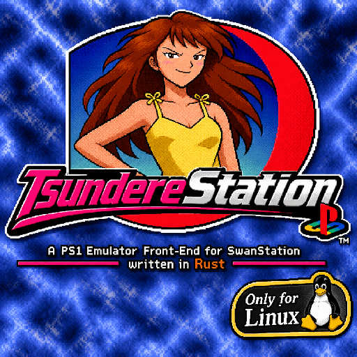

<p align="center">
  
</p>

<h1 align="center">TsundereStation</h1>

<p align="center"><em>“Anta baka?! Are you an idiot?!” — The Tsundere, after catching you using a non-free PS1 emulator like DuckStation.</em></p>

TsundereStation is free software: a standalone SwanStation PlayStation 1 emulator
front-end written in Rust with egui/eframe and SDL2. It loads
`swanstation_libretro.so` directly; RetroArch is not required.

It focuses on playing PS1 games with a good, controller-friendly TV UI. No
Discord integration, no RetroAchievements, no trophy popups, no bells and
whistles. Just the core, the games, and a tsundere attitude.

The app includes the TsundereStation logo and a short startup splash with the
provided motif. Both assets are embedded in the binary.

## Scope

- Free software under GPL-3.0-or-later.
- Standalone native front-end for the SwanStation libretro core.
- TV/controller-first launcher, file browser and pause menu.
- Mouse/keyboard settings, controller configuration, save states and themes.
- Linux only; software rendering for now.

Not in scope: Discord integration, RetroAchievements, accounts, cloud saves,
telemetry, or other online service integrations.

For implementation decisions and AI-agent guidance, see [`AGENTS.md`](AGENTS.md).

## Build

Build the core from the repository root first:

```sh
make -f Makefile.libretro platform=unix -j"$(nproc)"
```

Then build the frontend:

```sh
cd frontend
cargo build --release
```

The default build uses the system SDL2 development package (for example
`libsdl2-dev` on Debian/Ubuntu) and an OpenGL + X11/Wayland toolchain. If you
would rather compile SDL2 from source:

```sh
cargo build --release --features bundled-sdl
```

## Run

```sh
./target/release/tsunderestation
```

Useful flags:

```sh
# Boot directly into a disc image
./target/release/tsunderestation --game /path/to/game.cue

# Boot the BIOS shell (memory-card manager, BIOS test)
./target/release/tsunderestation --boot-bios

# Skip the startup splash for this run
./target/release/tsunderestation --no-splash

# Choose a different core library or BIOS directory
./target/release/tsunderestation --core /path/to/swanstation_libretro.so \
    --bios-dir /path/to/bios

# Headless smoke test: boot BIOS, run frames, save/load state, dump a frame
./target/release/tsunderestation --selftest

# Show the frontend version
./target/release/tsunderestation --version
```

The splash is shown for about four seconds and is skipped by any keyboard key,
mouse click, or controller button. It can be disabled with `--no-splash` or the
“Show splash on startup” checkbox in the launcher. `splash_seconds` in the
config file controls the duration.

The FPS/status overlay is hidden by default. Toggle it in-game with `F3`, from
the pause menu, or with the “Show FPS/status overlay” checkbox in the launcher.

## AppImage (AMD64)

A local AppImage build script is included:

```sh
./packaging/build-appimage.sh
```

It builds the core and frontend, downloads the AppImage tools into
`packaging/tools/`, creates `dist/AppDir`, and produces:

- `dist/TsundereStation-<version>-x86_64.AppImage`
- `dist/TsundereStation-x86_64.AppImage` (stable symlink)

The AppImage bundles `swanstation_libretro.so`, the desktop file, the icon, the
license, and a source note, so no separate core installation is needed.

Current builds target **Debian 13 / glibc 2.41 or newer**. Build on an older
distribution if you need a wider glibc baseline. This is a local-only build for
now; a future Debian 13 Forgejo Runner can reuse the script with
`--skip-build` after performing its own core/frontend build.

Useful options:

```sh
# Reuse already-built binaries
./packaging/build-appimage.sh --skip-build

# Build without running the AppImage selftest
./packaging/build-appimage.sh --no-test
```

Run the result:

```sh
chmod +x dist/TsundereStation-x86_64.AppImage
./dist/TsundereStation-x86_64.AppImage
```

AppImage type 2 requires FUSE2 on some systems. If FUSE is unavailable, run:

```sh
./dist/TsundereStation-x86_64.AppImage --appimage-extract-and-run
```

Optional desktop integration is provided by tools such as AppImageLauncher; the
AppImage itself runs standalone. The app’s config, BIOS, saves and states still
live under the usual `~/.config/tsunderestation` and
`~/.local/share/tsunderestation` paths.

## Themes

The frontend ships with the JAPS1ME theme selected by default, plus the complete
theme list embedded in `assets/themes.toml`. All UI colors, focus states,
warnings, errors, toasts and the splash accent follow the selected theme.

Select a theme in **Settings → Appearance**. The theme list shows each entry with
its own foreground/background and all 16 ANSI colors, and applies immediately.
The selection is stored as `theme = "<name>"` in the config file.

Enabled UI text keeps at least a **2.5:1** contrast ratio against its background.
Text on accent, focus, selected and toast fills is black or white, whichever has
the higher contrast ratio. If a theme's own foreground, muted or semantic colors
fall below the floor, those rendered text colors are adjusted toward black or
white by the smallest amount needed; the theme file and the ANSI color swatches
keep their original values.

Optional extra themes can be added in
`~/.config/tsunderestation/themes.toml`. Its entries are appended to the embedded
list; an entry with the same name updates the built-in theme in place. Use the
**Reload themes** button in Appearance after editing the file.

The theme file uses the same TOML shape as the embedded file:

```toml
["My Theme"]
foreground = "#f5f5f4"
background = "#101018"
normal = ["#101018", "#ff5555", "#55ff55", "#ffff55", "#5555ff", "#ff55ff", "#55ffff", "#f5f5f4"]
bright = ["#333340", "#ff7777", "#77ff77", "#ffff77", "#7777ff", "#ff77ff", "#77ffff", "#ffffff"]
```

## Data locations

Following the XDG base directory spec:

- Config: `~/.config/tsunderestation/config.toml`
- Optional themes: `~/.config/tsunderestation/themes.toml`
- BIOS images: `~/.local/share/tsunderestation/bios/`
- Memory cards: `~/.local/share/tsunderestation/saves/*.srm`
- Save states: `~/.local/share/tsunderestation/states/*.state`

On first run, an existing `swanstation-ui` config and data directory are migrated
to the new `tsunderestation` paths automatically. The data directory is moved when
possible; the old config file is left in place.

BIOS files are optional. If the BIOS folder is empty, the core uses its built-in
OpenBIOS. Use the launcher's “Add BIOS image…” button to copy a `.bin`, `.rom`,
or `.img` image into the managed BIOS folder; the core selects a region-appropriate
image on boot.

## Controls

The launcher, file browser and in-game pause menu are designed for TV use with
large rows and controller navigation. Settings and Controller windows use the
mouse/keyboard for now.

Controller navigation:

- Launcher: D-pad/left stick moves, Cross selects, Left/Right changes the selected controller
- File browser: D-pad/left stick moves, Cross opens/chooses, Circle closes
- In the pause menu: D-pad/left stick moves, Cross selects, Circle/PS closes
- Keyboard equivalents: arrow keys move, `Enter` selects, `Esc` closes

The rest of the controls:

Keyboard:

- `Esc` / `F1`: open/close the in-game menu
- `F5`: quick save (slot 0)
- `F8`: quick load (slot 0)
- `F3`: show/hide the FPS/status overlay
- `F11`: toggle fullscreen
- Hold `Tab`: fast-forward (audio muted, video shown)
- In the menu: arrow keys move, `Enter` selects, `Esc` closes

SDL game controller:

- `PS` / `Guide` button: open/close the in-game menu
- `Select + Start`: optional fallback menu combo (enable in Controller settings)
- In the menu: D-pad/left stick moves, Cross selects, Circle closes
- Left/Right changes the save-state slot
- The button used to resume from the menu is discarded until it is released
  (up to one second), so it does not reach the game
- The standard SDL gamepad mapping is used: Cross → PS1 Cross, Circle → Circle,
  Square → Square, Triangle → Triangle, shoulders → L1/R1, triggers → L2/R2,
  stick clicks → L3/R3.

If the PS button opens Steam's overlay instead of this menu, disable Steam Input
for the controller (or launch the frontend outside Steam). SDL's HIDAPI driver is
enabled by the frontend; if the controller is not detected, check hidraw/udev
permissions.

## Desktop install

The `install.sh` helper installs the frontend, the desktop entry, the icon, and
the built core under `~/.local`:

```sh
./install.sh
```

It copies:

- `~/.local/bin/tsunderestation`
- `~/.local/share/applications/tsunderestation.desktop`
- `~/.local/share/icons/hicolor/512x512/apps/tsunderestation.png`
- `~/.local/lib/libretro/swanstation_libretro.so` (if the core is built)

Make sure `~/.local/bin` is in your `PATH`. The frontend also searches for the
core next to the executable, in the current directory, in
`~/.local/lib/libretro`, and in `/usr/lib/libretro`; or set
`TSUNDERESTATION_CORE` / use `--core`.

## Current limitations

- Software renderer only. Hardware OpenGL/Vulkan rendering, internal-resolution
  upscaling and PGXP are not wired up yet.
- One controller is mapped to port 1; multitap and multiple controllers are not
  exposed yet.
- Multi-disc swapping is not exposed yet (single-disc images, and the first disc
  of an `.m3u`, work).
- Rewind, runahead and cheats are not exposed yet.
- Core options mostly apply on the next frame. When no game is running, changing
  an option automatically reinitializes the core so boot-time options apply to
  the next start. While a game is running, use the Settings window's “Restart
  core” button (the current game is reloaded automatically).
- Audio output uses SDL's default device at 44.1 kHz. If no compatible device is
  available the frontend still runs, silently.

## Layout

- `src/libretro/`: minimal hand-written libretro ABI, core loader, host callbacks,
  video/audio/input handoff.
- `src/emu.rs`: emulation worker thread, commands, save states and memory cards.
- `src/sdl_input.rs`: SDL controller discovery, mapping, rumble, menu navigation
  and the shared SDL audio callback (including the splash motif).
- `src/splash.rs`: embedded logo and motif decoding, branding helpers.
- `src/app.rs`: splash, launcher, in-game overlay, settings and controller windows.
- `src/theme.rs`: theme catalog, palette derivation, contrast rules, theme picker
  and custom window headers.
- `src/tv_ui.rs`: large full-width TV rows and controller hints.
- `src/config.rs`: config schema, XDG paths, legacy migration and core discovery.
- `src/filebrowser.rs`: small built-in file picker.
- `assets/`: embedded themes, logo, splash motif and desktop icon.
- `packaging/`: desktop entry and AppImage build script.

## Development notes

Implementation decisions and coding invariants are documented in
[`AGENTS.md`](AGENTS.md), including the theme contrast contract, egui gotchas,
version/artifact policy and verification checklist.
